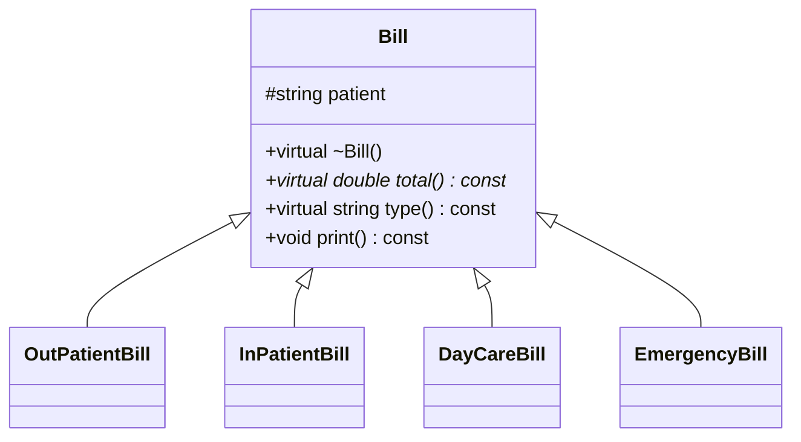

# PART A – DESIGN ANSWERS

## A1. Polymorphic Bill hierarchy
Common data: patient name/ID and bill number. Common interface: `total() const` (pure virtual), `type() const` (virtual), `print() const` (shared non-virtual function calling the virtual functions), and a virtual destructor.


`*` means pure virtual. Derived `total()` and `type()` implementations override the base functions.

Pseudocode:
```
ALGORITHM DailyTotal
 INPUT billPointers[0..n-1]
 SET sum <- 0
 FOR EACH bill IN billPointers
   IF bill IS NOT NULL THEN
     sum <- sum + bill.total()
   END IF
 END FOR
 OUTPUT sum
END
```
Alternative single struct + type/switch: per bill O(1), n bills O(n) in both designs. Switch version stores fields for all possible bill kinds, often wasting per-object space. New type requires modifying enum, switch and related logic. Polymorphism allows a new derived class without editing existing bill classes; objects commonly carry a vptr-sized implementation overhead.

## A2. Runtime binding
Early binding resolves non-virtual calls from the static type at compile time. Late binding resolves virtual calls using the dynamic object type at runtime. A `Bill*` pointing to an `OutPatientBill` calls `OutPatientBill::total()`.

Conceptual vtable (actual ABI layout is compiler-dependent):
| Dynamic class | total slot | destructor slot |
|---|---|---|
| Bill | pure virtual handler | Bill destructor |
| OutPatientBill | OutPatientBill::total | derived then base destructor |
| InPatientBill | InPatientBill::total | derived then base destructor |

`b->total()` uses the object's vptr to find the derived implementation. `show()` can be non-virtual and still call the derived `total()` because the call inside it is virtual.

A base class deleted through `Bill*` needs a virtual destructor. Without it, deleting a derived object through a base pointer is undefined behaviour; derived cleanup is not guaranteed.

PDF A2 prediction:
```
500 ~OPBill ~Bill
```
Removing `virtual` from the base destructor makes deletion undefined behaviour; do not promise a particular output. Verify with the requested sanitizer experiment.

Alternative dynamic_cast approach may test up to k concrete types per bill, rather than one virtual dispatch. Vptr size is implementation-dependent.

## A3. Payer interface
`Payer` is abstract with `virtual double amountCovered(const Bill&) const = 0`. `SelfPay` covers the full bill. `Insurance` stores a cover limit and co-payment percentage; insurer share is bill total × (100 − copay)% capped at cover limit. `GovernmentScheme` stores package rates and rejects unknown package codes. Add `CorporatePayer : Payer` with its own policy without changing existing classes.

Alternative `std::function`: store a callable policy, with limits captured in a lambda or state object. Calls are O(1) like virtual dispatch. Abstract classes group state and behavior; function objects offer flexible callable policies with possible type-erasure/storage overhead.

## A4. Exception strategy
Errors: negative charges/duration, claim above cover, unknown package, missing patient record, invalid numeric text (`invalid_argument`/`out_of_range`), and allocation failure (`bad_alloc`).

Hierarchy:
```
std::exception
  └─ std::runtime_error
      └─ BillingError
          ├─ ClaimError
          ├─ InvalidCharge
          ├─ UnknownPackage
          └─ MissingPatient
```
Validation and allocation-related operations may throw. Destructors and cleanup should not throw; throwing during stack unwinding can call `std::terminate`. Use `noexcept` for cleanup functions that guarantee no exceptions.

Alternative return codes: return `Status`/result plus error detail. Normal path has explicit checks; every caller must inspect and propagate status. Exceptions separate error flow but should not be used for routine expected outcomes without considering frequency.

## A5. Recovery and rethrow
Catch/log where useful context is available; use `throw;` to rethrow the same active exception; catch at the application boundary to report to the user. Stack unwinding destroys automatic objects in reverse construction order. RAII (`string`, `vector`, `unique_ptr`, file streams) releases resources automatically.

PDF A5 prediction:
```
~f ~main caught 42
```
`Guard g("f")` is destroyed leaving `f`; then `Guard m("main")` is destroyed leaving the try scope; `not printed` is skipped.

Manual `delete` in every catch has similar basic resource-release work but duplicates cleanup across error paths. A new path can omit a delete and leak. RAII centralizes cleanup.

## Part B guidance
B1 sample expected totals: OP 1700; IP 47500; combined 49200. Removing `virtual` from a pure virtual declaration makes the declaration invalid; a non-virtual function cannot provide runtime dispatch through the base interface.

B2: `throw;` preserves the original dynamic exception type. `throw e;` throws the static type of expression `e`, potentially slicing a derived exception. An impossibly large allocation may fail differently across operating systems; record actual behavior.

B3: run with `-O2`; record your own times for 1k, 1m, 10m bills and 0%, 1%, 50% invalid validations. Results depend on compiler, CPU, OS and load. `variant` stores its active alternative inline using storage sufficient for the largest alternative plus a discriminator/alignment; `visit` dispatches based on the active type.

B4: sample extension adds `DayCareBill` and `CorporatePayer` without modifying existing interfaces. Plug-in/configuration rules can make rate changes data-driven, but require validation/versioning and cannot necessarily express new structural algorithms without code.
